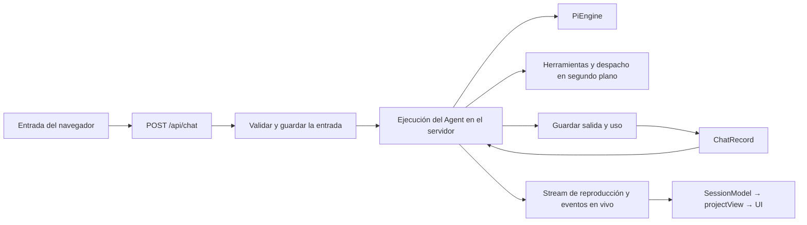
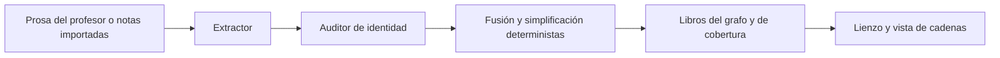

# Arquitectura

LearnHarness es una aplicación Next.js con un host de escritorio en Electron. El servidor es dueño de las ejecuciones del agente, los registros de conversación, el trabajo en segundo plano y la persistencia en el sistema de ficheros; el navegador proyecta esos registros en una interfaz de lección/práctica y en el grafo de conocimiento.

Esta referencia describe el [código fuente del repositorio](README.md#sobre-esta-documentación). Consulta [Desarrollo](development.md) para los comandos y [la teoría de la enseñanza](teaching-methodology.md) para la intención pedagógica.

## Límites del código

| Área | Responsabilidad / puntos de partida |
| --- | --- |
| `app/` | Páginas y transporte HTTP; `api/chat/route.ts`, `api/chats/` |
| `components/` | Estado y presentación en el navegador; `session-core.ts`, `chat.tsx`, `graph-view.tsx` |
| `src/server/` | Composición, admisión, vivacidad (liveness), servicios expuestos por HTTP; `chat-handler.ts`, `jobs.ts`, `stores.ts` |
| `src/agent/` | Construcción del agente, herramientas, streams de proveedores, workers; `teacher-agent.ts`, `models.ts`, `tools.ts`, `subagents/` |
| `src/core/` | Contratos, proyecciones de registros/vistas, algoritmos del dominio; `input-events.ts`, `native-messages.ts`, `view.ts`, `graph.ts` |
| `src/store/` | Adaptadores del sistema de ficheros para chats, tareas, grafo, ajustes y credenciales |
| `electron/` | Arranque del escritorio, protecciones de navegación/permisos, transporte de credenciales, asistente de navegador, actualizador |

[`eslint.config.mjs`](../eslint.config.mjs) restringe las importaciones de la carcasa hacia `src/` a los barrels de core/server, impide que el núcleo importe capas de E/S e impide que los agentes importen adaptadores de servidor/almacén. Las dependencias llegan mediante contextos/puertos inyectados. Estas reglas no demuestran que el núcleo sea puro, que haya una única raíz de composición ni un único escritor por almacén: algunos módulos del núcleo dependen de Node y están excluidos del barrel del navegador; los módulos del servidor pueden importar adaptadores. Los scripts, Electron y las pruebas quedan fuera de estas zonas.

## Conversaciones y turnos

Una **conversación** es un `ChatRecord` duradero con `LhMessage[]` nativos, ajustes, un plan opcional y registros de uso. Si falta `kind`, se trata de enseñanza; `practice` selecciona al practicante. Un **motor** es el modelo de Pi resuelto, su función de stream y su nivel de razonamiento. Un **turno** de la aplicación construye un `Agent` nativo de Pi nuevo a partir del historial guardado; puede hacer varias llamadas al modelo y ejecutar herramientas. No es una conexión HTTP ni una única generación.

[`chat-handler.ts`](../src/server/chat-handler.ts) resuelve si todo está listo, espera a la compactación, vuelve a leer la verdad duradera y reclama la vivacidad por chat. Un turno competidor recibe **409**. La entrada aceptada se guarda antes de la inferencia; en cambio, las entradas automáticas con suscripción pueden quedar preparadas hasta la admisión del despacho. La respuesta HTTP confirma la admisión, mientras que `GET /api/chats/:id/stream` transporta los eventos de reproducción y en vivo y un estado terminal.

El registro almacenado tiene dos proyecciones:

- [`toLlmMessages`](../src/core/native-messages.ts) elimina los metadatos de la aplicación, aplana los marcadores dirigidos al modelo, aplica el corte de compactación activo y repara, en el límite con el proveedor, los pares de herramientas interrumpidos que cumplan los requisitos.
- [`projectView`](../src/core/view.ts) deriva los mensajes de la interfaz, los docks de preguntas/problemas y los artefactos. No es el formato almacenado ni lo que viaja al proveedor.

Pi siembra el prompt de sistema y las herramientas al construirse; ese mensaje de sistema sintético no se persiste. Por tanto, los turnos nuevos reciben las instrucciones vigentes. La aplicación no usa la sustitución de la transcripción del cliente del AI SDK ni el bucle `addToolOutput`.

El cierre (settlement) persiste los mensajes nativos nuevos, las instantáneas del plan y el uso, incluida la salida parcial al abortar. Si falla la escritura de la entrada, se rechaza la inferencia; los fallos al escribir la respuesta se muestran antes del estado terminal y no se hacen pasar por turnos vacíos correctos. La limpieza libera la vivacidad. Un aviso de fallo solo en memoria puede informar a las vistas que se vuelven a conectar sin inventar contenido de transcripción guardado.

### Streaming y recuperación

[`pi/ui-stream.ts`](../src/server/pi/ui-stream.ts) emite eventos nativos del agente. Las actualizaciones de mensajes parciales sustituyen una ranura; no son deltas de texto acumulados. La reproducción conserva los eventos cerrados y las últimas actualizaciones en curso, con difusión en vivo agrupada. Los ID de herramienta se hacen únicos respecto al historial para que la persistencia, el enrutamiento de respuestas y el contexto del proveedor coincidan.

Desconectar un navegador desacopla una vista, no el agente. Abortar explícitamente es otra cosa. [`session-core.ts`](../components/session-core.ts) se encarga de volver a conectarse, de la recuperación acotada ante 409 y de adoptar el estado canónico. Se permite una conexión de recuperación tras un EOF prematuro o un fallo de lectura; los fallos de transporte repetidos muestran un error.

Los borradores de las preguntas sobreviven en memoria al desmontaje optimista. Los envíos inciertos se concilian con el registro guardado y el estado de ejecución antes de reenviarse, limitados a la misma aparición de la pregunta. El reintento de las respuestas del proveedor es explícito: conserva en disco los intentos fallidos y omite la cola fallida que cumpla los requisitos del contexto temporal del modelo. No es una reproducción al montar ni un reintento automático de fallos arbitrarios.

### Preguntas laterales

Cada explicación y su pregunta asociada comparten una conversación lateral duradera en las sesiones de enseñanza y de práctica. Una entrada discreta con un bocadillo en el historial de mensajes, o **Preguntar** sobre un texto seleccionado, abre esa conversación en una ventana flotante que se puede mover, con un dock lateral opcional ([`side-thread.tsx`](../components/side-thread.tsx), [`use-side-thread.ts`](../components/use-side-thread.ts)). Cerrarla solo la oculta; los intercambios guardados se pueden volver a abrir. El acompañante nunca cambia de conversación en silencio a medida que avanza la sesión; **Ir al paso actual →** abre, si se quiere, el historial independiente de ese paso, conservando el acoplamiento y los borradores de cada hilo. Las conversaciones anteriores siguen siendo utilizables y reciben la última lección visible en cada petición. Fijar/Soltar alterna entre la presentación flotante y la acoplada. Ambas usan el fondo del tema: opaco cuando está acoplado y con un 50 % de opacidad y un desenfoque de fondo de 18 px cuando flota. El campo de entrada usa la superficie de tarjeta opaca del compositor principal. Los cuatro bordes y las cuatro esquinas redimensionan el panel flotante; los bordes opuestos se mantienen anclados, con el ancho por defecto de 416 px como mínimo preferido y prioridad para las ventanas más pequeñas. Las dimensiones elegidas se conservan al cambiar de conversación mientras flota; el dock mantiene su ancho actual. El panel flotante solo deja libre la esquina de los semáforos de macOS, compartiendo las dimensiones del margen nativo y el estado real del zoom; la colocación en un navegador normal no cambia. Los mensajes del alumno son bocadillos alineados a la derecha con un ancho máximo del 70 %; las respuestas del asistente van sin recuadro. El micrófono en línea usa el grabador existente con un destino explícito de borrador lateral: el atajo sigue al foco del compositor lateral, una grabación conserva su destino inicial y cerrarla la vuelca en ese borrador guardado. Tres barras compactas muestrean localmente la señal RMS existente del grabador mientras se graba; no se animan en silencio ni vuelven a renderizar el chat principal. Enter en los controles laterales se queda dentro del acompañante, también cuando está acoplado. El dictado principal mantiene su propia reclamación de la entrada y el envío principal nunca espera a la grabación lateral. Los pasajes seleccionados conservan su mensaje nativo original y su selector de texto exacto como metadatos canónicos de la cita, con independencia de la cabeza de segmento del hilo. **Citar** es otra cosa: inserta un chip de cita atómico en el último compositor principal o campo de razonamiento que tuvo el foco, y expande esa cita cuando la entrada se envía al modelo.

Una respuesta lateral **no es un turno de la aplicación**. [`server/side-chat.ts`](../src/server/side-chat.ts) gestiona una llamada en streaming sin herramientas por conversación con el modelo seleccionado en la sesión, con comprobaciones de que el modelo y la clave estén listos pero sin la vivacidad del turno principal, de modo que una comprobación, un problema activo o un turno principal en ejecución no la bloquean. El asistente recibe una reconstrucción en texto de la lección visible para el alumno como documento citado, no el tráfico interno de herramientas ni un resumen de compactación ([`core/side-chat.ts`](../src/core/side-chat.ts)). Las comprobaciones abiertas y los problemas activos omiten las claves de respuesta, las explicaciones y las soluciones comprometidas; las opciones de las preguntas usan el orden barajado determinista del alumno. El asistente recibe su propio hilo una vez, por separado de la lección. Su fragmento fijo de brevedad, exclusivo de lo lateral, sigue al apéndice compartido de voz/exactitud/formato y favorece la respuesta útil más breve —normalmente una o dos frases cortas— en lugar de una minilección. Cerrar desacopla la vista; Detener conserva la respuesta parcial. El uso aceptado se registra en `turns` con el id de la respuesta lateral. Los cambios se anuncian en `side-chats-changed`; las rutas están en `app/api/chats/[id]/side-chats/`.

`ChatRecord.sideChats` guarda el historial vivo de la interfaz. Al empezar el turno principal y antes de cada llamada interna posterior al modelo, el servidor reúne los nuevos intercambios en bruto de **todas** las conversaciones, incluidos los pasos anteriores, y añade entradas personalizadas `side-question` atribuidas sin cambiar el historial nativo anterior. Las actualizaciones internas usan el hook de preparación del siguiente turno del SDK, con los eventos normales del ciclo de vida de los mensajes tras los resultados de las herramientas. La primera llamada y las llamadas de recuperación de la admisión reciben la carga nueva mediante el sondeo inicial de reorientación del SDK. Ninguno de los dos caminos interrumpe una llamada activa ni programa una respuesta adicional del profesor. Se persisten con ese turno en ejecución, usando su contrato de cierre/fallo existente. El disparador de compactación previo al turno incluye los posibles intercambios laterales, pero solo resume el historial ya guardado, no esos intercambios nuevos. El hook final de la petición del SDK comprueba el contexto real, una vez incorporadas las referencias preparadas y las reorientaciones encoladas, en las llamadas iniciales e internas, frente al presupuesto de entrada del modelo seleccionado (con la reserva de salida limitada por su salida máxima; una ventana desconocida usa el presupuesto configurado). Los intercambios nuevos demasiado grandes quedan pendientes, sin marca de entrega: una respuesta fallida local y accionable conserva la entrada principal y las herramientas completadas para Reintentar o usar un modelo más grande. No hay compactación interna, ni llamada automática adicional al profesor, ni descarte silencioso, ni resumen de los intercambios nuevos. Un rechazo local restaura la entrada automática no admitida sin recuperación de la autorización; su error sigue visible. Se omite el impulso de compactación al cerrar para que Reintentar siga disponible, y ese Reintentar solo puede atravesar la compactación que haga su propio control previo, no una compactación anterior ni entradas intermedias. Los descartes silenciosos en reposo o aparcados solo registran el descarte; no pueden publicar de antemano intercambios laterales sin comprobar en el historial de compactación. Las respuestas en vivo aportan solo el texto disponible en ese momento; una petición posterior añade el sufijo restante y el estado terminal, nunca el prefijo ya registrado. Las correcciones que no son un prefijo se atribuyen explícitamente como redacción actualizada en lugar de sustituir en silencio el texto anterior. La entrada principal sigue siendo de escritura anticipada; los intercambios laterales en bruto ya son duraderos en `sideChats`. Las entradas de referencia provisionales pasan la validación final de la petición y, con suscripciones, el control de admisión del despacho existente. Solo las entradas admitidas se publican con el cierre del turno en ejecución; un rechazo retira únicamente las referencias transitorias no admitidas, no las reorientaciones del alumno, las herramientas completadas, las entradas admitidas anteriormente ni el historial en bruto. Esas entradas inmutables contienen las marcas de entrega, que sobreviven al reinicio y a la compactación; las peticiones no admitidas y los guardados fallidos no pueden consumir intercambios nuevos. Una ejecución efímera interrumpida se notifica una sola vez si su parcial publicado no tiene una respuesta superviviente. Las preguntas hermanas aplazan la entrega hasta que todos los resultados nativos sean adyacentes. Las peticiones principales nunca esperan a un asistente, y el cierre de un asistente nunca escribe por su cuenta entradas en el contexto principal. La proyección nativa para el modelo representa las actualizaciones como referencia con rol de usuario, no como respuestas del tutor; el fragmento compartido explica la procedencia y las continuaciones. Las actualizaciones están disponibles para el contexto del profesor/la práctica y para la compactación, pero la lógica de extracción o de continuación no las trata como nuevos envíos del alumno. La versión 2 del registro de chat separa este contrato de las aplicaciones anteriores; las entradas antiguas de instantáneas de desarrollo no cambian y siembran el nuevo libro de entregas.

## Enseñanza y práctica

[`teacher-agent.ts`](../src/agent/teacher-agent.ts) y el [registro de herramientas](../src/agent/tools.ts) componen distintos agentes sobre el mismo historial de enseñanza:

| Agente | Interacción | Otras herramientas |
| --- | --- | --- |
| Sondeador | `probe` o `recall`, `ask_user_question`, `probe_done` | Ficheros de solo lectura, despacho de investigación/PDF; lectores del grafo condicionados |
| Profesor | `quiz` o `explain`, `ask_user_question`, `plan_init` | Ficheros de solo lectura, despacho de investigación/PDF/demostraciones/visuales; `show_image` |
| Practicante | `problem`, `conclude` | Ficheros de solo lectura, despacho de investigación/PDF; lectores del grafo condicionados |

Las elecciones de mecánica, los interruptores de ajustes y la disponibilidad afectan a lo que está accesible. Las herramientas auxiliares de práctica se componen por separado de los interruptores de enseñanza. Los agentes de la familia Claude pueden recibir `send_to_user`. La reparación de argumentos precede a la validación semántica; las llamadas no válidas devuelven errores que el modelo puede corregir.

Las herramientas de preguntas se validan y ejecutan en el servidor y devuelven un marcador sintético de terminación. Detiene limpiamente el planteamiento de una pregunta, incluso en lotes mixtos de herramientas, pero no se guarda. La respuesta real del alumno se convierte más tarde en el resultado de la llamada. El navegador baraja las opciones y corrige las preguntas de selección; en el recuerdo libre se expone la respuesta comprometida para que la juzgue el modelo. Las preguntas pendientes hermanas se responden sin inferencia hasta que se resuelve la última.

Un resultado correcto y coincidente de `probe_done` selecciona al profesor y encola el relevo a un agente nuevo. Una llamada vacía o rechazada no lo hace. La planificación empieza en esa costura; la enseñanza visible empieza en el primer `quiz`/`explain` etiquetado con un nodo, no en `plan_init`. El plan es un DAG Mermaid validado que se puede sustituir mediante `plan_init`. Las posiciones actual/visitadas se derivan de las llamadas etiquetadas, no de las notas. Esperar la respuesta natural del alumno al plan es doctrina del prompt, no una transacción de aceptación.

La práctica usa el mismo camino de turno/persistencia/recuperación, no un servicio aparte de conjuntos de problemas. [`tools/practice.ts`](../src/agent/tools/practice.ts) compromete un enunciado y una solución con `problem`; `conclude` registra el resultado y revela esa solución. Un control con ámbito de turno impone un único problema activo. La pausa tras la conclusión es doctrina, no un resultado `conclude` de terminación. Siguiente añade un marcador explícito. Los resultados de la práctica son evidencias de la sesión, no dominio en el grafo; el cierre normal de la práctica omite la extracción.

La [composición de prompts](../src/agent/prompts/README.md) y la [recuperación del contenido de herramientas para su visualización](tool-content-recovery.md) tienen referencias aparte. Los plugins pueden añadir tipos acotados de preguntas/problemas sin sustituir los integrados; consulta [Plugins locales de confianza](#plugins-locales-de-confianza-api-v1).

## Trabajo en segundo plano

Las herramientas de investigación, PDF, demostraciones y visuales persisten tareas, confirman el despacho e inician workers independientes mediante [`subagents/runner.ts`](../src/agent/subagents/runner.ts). Las demostraciones se comprueban con el asistente de navegador; los visuales usan bucles de renderizar e inspeccionar. El renderizado de PDF/SVG es nativo; la ejecución de las demostraciones usa el servicio de navegador de Electron, con Chrome del sistema como alternativa. Los SVG de figuras normales reciben las mismas dos reparaciones, solo de renderizado, que en su visualización (un espacio de nombres raíz ausente y el `&nbsp;` de HTML) y después se rasterizan únicamente con resvg. Las entradas de las anotaciones siguen siendo estrictas. Los SVG guardados/descargados no se reescriben. Los fallos nativos de análisis/renderizado de SVG pasan a la gestión de revisión/fallo existente del creador de visuales, nunca a una alternativa en el navegador; el contenido no admitido que resvg ignora en silencio no lo rescata otro motor.

La finalización del worker y la entrega a la sesión son cosas distintas. El worker guarda su resultado y los metadatos de entrega pendiente antes de encolar un marcador. [`server/jobs.ts`](../src/server/jobs.ts) entrega reorientando a un agente vivo en un límite nativo o despertando una sesión inactiva que cumpla los requisitos. Las preguntas pendientes, la pausa, el consentimiento o las carreras de admisión pueden retener la entrega. Solo se pueden abortar los workers que están calculando.

Un marcador en la **conversación guardada** confirma la entrega, no la aceptación HTTP ni la visibilidad en un stream. La conciliación evita reproducir resultados guardados; la recuperación tras un reinicio restaura las obligaciones pendientes conocidas y puede volver a lanzar workers integrados sin terminar. Las tareas de plugins se recuperan a partir de los registros canónicos de tareas sin volver a ejecutar código de plugins. Las tareas terminales antiguas sin metadatos de entrega no se suponen para reproducirlas. Borrar una sesión descarta sus obligaciones.

Es coordinación de un único proceso sobre ficheros JSON, no una cola transaccional ni una ejecución en el proveedor de exactamente una vez. Las reorientaciones del compositor en memoria no tienen la misma durabilidad que la entrega de tareas.

### Admisión compartida de peticiones de workers

Una única puerta FIFO global del proceso limita los **streams de peticiones al modelo** en segundo plano y libera cada permiso cuando termina la petición, antes de las herramientas o de las esperas de procesos hijo, no cuando termina el agente completo. Ajustes → Agente → Modelos → **Peticiones de workers concurrentes** (`agent.workerRequestConcurrency`) vale **8** por defecto, también cuando no está definido. Se acepta cualquier entero positivo representable con seguridad, sin un tope arbitrario; los valores no válidos se rechazan, no se recortan. Un aumento en vivo vacía de inmediato las peticiones encoladas hasta el límite; una reducción deja terminar las peticiones activas y solo admite otra cuando el número de activas queda por debajo del nuevo límite. Cancelar una petición encolada impide su despacho al proveedor.

Las peticiones del núcleo de extracción/auditoría/investigación/demostraciones/visuales/PDF y todas las tareas desacopladas de `ctx.workers` comparten el pool, incluso las iniciadas por el usuario. Quedan excluidas las peticiones directas del profesor, el sondeador y la práctica y su compactación, las conversaciones interactivas gestionadas por plugins y la inferencia en bruto independiente de los plugins. `purpose` rige el consentimiento de la suscripción, no la clasificación de los workers. Las rutas y las ventanas comparten un pool dentro de un proceso de servidor de la aplicación, nunca entre procesos de servidor independientes. Los fragmentos de extracción en serie por fuente, el bloqueo de coherencia de auditoría-hasta-fusión y la cola de subida de tres ficheros del frontend siguen siendo independientes de esta puerta. Consulta el [mapa de trabajo/recuperación del host de plugins](plugin-architecture.md#inferencia-trabajo-persistente-y-recuperación).

### Instantáneas de imágenes del alumno

`show_image` muestra una imagen rasterizada local; `visual` con una ruta de imagen la anota. Ambas usan la política de acceso a ficheros y el procesamiento compartido: límites de entrada de 25 MiB, 16 megapíxeles y 8192 px por lado; limpieza de orientación/metadatos fuera del hilo principal; PNG/JPEG almacenado limitado a 1600 px por lado y por debajo de 1 MiB en base64.

[`learner-image.ts`](../src/agent/tools/learner-image.ts) guarda los bytes procesados con identidades SHA-256 en `ChatRecord.imageSnapshots`, sin duplicados dentro de cada sesión. Las tarjetas y los SVG de anotación hacen referencia a las instantáneas, así que mover el original no rompe los resultados guardados. Las lecturas de imágenes con ámbito de sesión resuelven las referencias; las descargas de SVG incrustan su imagen. El anotador edita un href marcador, no base64, y usa renderizado nativo estático. Los SVG visuales normales conservan su comportamiento. Las pruebas de regresión sin conexión ejercitan el almacenamiento de instantáneas, la visualización y la entrega de la carga útil, no la calidad de las anotaciones hechas por el modelo.

## Grafo de conocimiento e importaciones

El grafo registra proposiciones objetivas y cadenas de razonamiento que las implican conjuntamente, no niveles de comprensión del alumno. La construcción es a posteriori e independiente del plan de la lección:

[`coverage.ts`](../src/core/coverage.ts) calcula huellas de la prosa del profesor, incluido el texto correcto de `send_to_user`, por el ID real del mensaje. El texto del alumno, el razonamiento, las preguntas, otros resultados de herramientas y los marcadores no cuentan. La extracción automática depende de `graph.enabled` y de un umbral de tokens no cubiertos (por defecto **4096**, mínimo **500**). La representación es un interruptor aparte. Las rutas manuales de extracción/importación no comprueban por sí mismas el interruptor de extracción automática.

El pipeline agrupa en lotes los mensajes no cubiertos más antiguos sin partir ningún mensaje. Los presupuestos de disparo y de lote son distintos: el cableado actual de la aplicación no inyecta el valor de disparo configurable como presupuesto de lote. Los lotes de cada fuente se ejecutan en serie; el trabajo entre fuentes puede solaparse bajo la puerta de admisión compartida a nivel de petición. Un bloqueo FIFO de todo el proceso serializa desde la auditoría hasta la fusión. Estos registros sobreviven entre entradas de módulos gracias a `globalThis`, no entre procesos de servidor distintos.

El [extractor](../src/agent/subagents/extraction.ts) lee el texto fuente y propone proposiciones/cadenas ancladas. El auditor ve las proposiciones y el grafo actual, no los pasajes fuente ni las cadenas, y envía vínculos de identidad. El fusionador determinista resuelve identidades/extremos, une la procedencia, elimina argumentos duplicados, simplifica cadenas redundantes y guarda un punto de control de la cobertura tras las escrituras en el grafo. Las etapas fallidas dejan el material sin cubrir; los fragmentos completados y el uso sobreviven a un fallo o aborto posterior. Las operaciones ordenadas sobre los libros no son una transacción atómica de varios ficheros.

### Notas y organización de fuentes

`POST /api/graph/import` introduce en el mismo pipeline texto o Markdown de PDF convertido en local, sin anclas a mensajes de chat. Antes de registrar la fuente o de extraer, la ruta aplica la lista compartida de extensiones de fichero, reconoce los PDF por su cabecera `%PDF-` y rechaza los demás ficheros que contengan un byte cero en los primeros 8 KiB. Los ficheros que no son PDF se decodifican como UTF-8; la regla del byte cero es una heurística limitada para ficheros binarios, no una validación completa del texto o la codificación. La [interfaz de importación](../components/notes-import.tsx) encola una petición por cada fichero compatible, con hasta tres en curso. Los ficheros están limitados a 25 MiB; el total de bytes de fichero por petición en el servidor también está limitado a 25 MiB, con un límite de 26 MiB para multipart/proxy. La conversión de PDF no tiene OCR; se informa de las páginas omitidas que solo contienen imágenes y de las salvedades de los escaneos.

La identidad de la fuente es un hash de la ruta/nombre original; se pueden aportar rutas relativas a la carpeta seguras junto con los nombres de fichero correspondientes. Renombrar o reorganizar una fuente mostrada no cambia su identidad. Toda importación explícita procesa el fichero completo, aunque el texto no haya cambiado; reintentar no es un procesamiento de exactamente una vez. El solapamiento sobre la misma fuente se rechaza como ocupado. Los resultados por fichero distinguen completado, parcial, fallido, abortado y ocupado; cero hallazgos puede seguir siendo una importación completada.

`graph/source-organization.json` guarda las personalizaciones de visualización y la colocación en carpetas, no el contenido original de los ficheros. Las importaciones de carpetas reconstruyen los directorios que contienen ficheros compatibles. La organización es independiente de la colocación en la barra lateral de sesiones. Tanto el navegador de cadenas como el selector de nodos de la práctica ocultan las filas de fuentes de sesiones de práctica; es una proyección de lectura, no un borrado de conversaciones, aportaciones al grafo o colocaciones. La selección de carpetas excluye esas fuentes ocultas. Los nombres de fuente vacíos se atenúan en su sitio, usando el contenido completo y no los recuentos filtrados por la búsqueda. La selección normal en la vista de cadenas selecciona fuentes/carpetas, incluidos los descendientes ocultos por la búsqueda; la práctica puede seleccionar material del grafo con más detalle.

Borrar fuentes elimina sus aportaciones al grafo y conserva el conocimiento que esté respaldado en otra parte. Borrar también las conversaciones es una opción explícita, desmarcada por defecto. Los controles previos de extracción/trabajo en curso impiden borrados conflictivos; los fallos del sistema de ficheros pueden dejar un progreso parcial notificado. La organización de fuentes usa actualizaciones validadas basadas en operaciones. Estas garantías no son una transacción sobre todos los ficheros del grafo y de las sesiones.

### Modelo de lectura y otros escritores

[`graphSnapshot`](../src/core/graph.ts) deriva la presentación sin iniciar la extracción. Los argumentos de una sola premisa dibujan flechas directas; las premisas conjuntas producen uniones geométricas, no proposiciones almacenadas adicionales. Los clústeres se derivan de la procedencia de la fuente de origen, no de embeddings, Louvain ni nombres puestos por un LLM. Los ajustes de disposición/representación se persisten en el servidor; el estado de la cámara es local de cada dispositivo.

Las herramientas del grafo del sondeador y de la práctica requieren tanto el interruptor del grafo como el de las herramientas del grafo; el profesor no tiene registro de lectores del grafo. Las selecciones explícitas del grafo al crear la sesión son un camino de contexto aparte, no una inyección semántica automática de los K mejores.

La extracción es el escritor de construcción, no la única modificación: el borrado de fuentes/sesiones/nodos, la simplificación y la confirmación de posiciones también escriben ficheros del grafo. Borrar una proposición elimina las cadenas que la usan; conservar el grafo al borrar una sesión mantiene la procedencia y elimina la contabilidad de la extracción.

## Almacenamiento y notificaciones

[`config.ts`](../config.ts) ancla los recursos de prompts inmutables a la raíz de la aplicación y el estado modificable a `LH_DATA_DIR` (por defecto, `data/` del repositorio). Los puertos de almacenamiento son interfaces semánticas de [`ports.ts`](../src/core/ports.ts).

| Datos | Ficheros |
| --- | --- |
| Conversaciones, planes, uso, instantáneas de imágenes, preguntas laterales | `chats/*.json` |
| Cálculo de los workers y obligaciones de entrega | `jobs/*.json` |
| Proposiciones, cadenas, puntos de control, cobertura | `graph/{nodes,chains,sessions,coverage}.jsonl` |
| Fuentes, organización, posiciones, preferencias de representación | Mapas JSON en `graph/` |
| Preferencias y personalizaciones de prompts | `settings.json`, `prompts/` |
| Registros modificables de los plugins del núcleo | `core-plugin-data/<id>/` |
| Código y registros modificables de los plugins de la comunidad | `plugins/<id>/{dist,data}/` |
| Claves y vinculación del endpoint personalizado | `auth.json` aparte, seleccionado con `LH_AUTH_FILE` |

Los adaptadores usan operaciones síncronas del sistema de ficheros. Las lecturas JSONL omiten las líneas corruptas o no válidas; la derivación del grafo fusiona las afirmaciones repetidas. Algunas sustituciones usan el renombrado de un fichero temporal, pero las escrituras normales de ficheros completos no son transacciones de base de datos. La serialización dentro del mismo bucle de eventos no es un bloqueo entre procesos ni atomicidad frente a fallos. Usa **un único servidor propietario por perfil de datos/autenticación**.

Los chats y los ficheros de la familia del grafo tienen controles de versión separados; las marcas ausentes se leen como v1 y las versiones más nuevas se rechazan. Las posiciones se pueden reconstruir y no llevan marca. Los ajustes tienen su propia política de versión/saneamiento. Los contadores de formato no son versiones de la aplicación. Los fixtures dorados ejercitan la compatibilidad. La inicialización del almacén del grafo elimina los libros retirados, así que importar los almacenes no es un método de inspección universalmente de solo lectura.

`/api/chats/:id/stream` es un stream de turno/vista. `/api/events` es un stream de notificaciones aparte, a nivel de ventana: una señal efímera y local del proceso para descargar los datos canónicos. [`SERVER_EVENT_TYPES`](../src/core/events.ts) es el vocabulario de eventos. Los consumidores aplican debounce y vuelven a descargar al reconectarse; las notificaciones no tienen reproducción duradera. El estado terminal de un turno en vivo controla la adopción del cierre, de modo que la descarga provocada por una notificación no sobrescribe un estado parcial. El cierre señala el final del trabajo, no la prueba de una escritura correcta en disco.

## Host y proveedores

Electron empaquetado lanza un proceso hijo privado de Next standalone en loopback, establece las rutas de datos/autenticación y carga un renderizador en sandbox. Sus protecciones de navegación/permisos y de transporte de credenciales son límites del escritorio, no autenticación multiusuario web. [Versiones de escritorio](desktop-release.md) cubre las comprobaciones de trazado y empaquetado.

[`models.ts`](../src/agent/models.ts) compone los proveedores de Pi y los puentes de la aplicación. Las ranuras Potente/Barato/Visión no tienen modelos fijados de fábrica. Las sesiones conservan las elecciones explícitas; los roles en segundo plano se resuelven de forma independiente. Si falta configuración o no está todo listo, se rechaza en lugar de elegir en silencio otro proveedor.

Los valores de API del entorno prevalecen sobre las claves guardadas. Las credenciales de renovación de las suscripciones empaquetadas se quedan en el proceso principal de Electron; web/desarrollo usa ficheros de conexión propiedad del servidor. Las rutas de suscripción no recurren a la facturación por API. [Claude Code](claude-code.md) conserva la autenticación/enrutamiento nativos de la CLI, pero hace de puente con las herramientas de LearnHarness; los [endpoints personalizados](custom-providers.md) vinculan la autorización a la URL/modo y resuelven los ajustes en cada operación. Ninguna de las dos rutas tiene un precio inferido de cero dólares. [Contabilidad](compaction-accounting.md) es la referencia de la semántica de contexto/caché/coste.

### Acceso a ficheros y servicios externos

Las herramientas de ficheros de solo lectura usan por defecto el directorio personal del usuario del servidor, no un proyecto seleccionado ni la raíz de datos de la aplicación. Las exclusiones del recorrido reducen el ruido; no son una autoridad de acceso. Los adjuntos de sesión llevan rutas locales en lugar de subidas.

La **protección de rutas sensibles** rechaza ubicaciones privadas conocidas del directorio personal, los ficheros `.env`, los ficheros de autenticación/suscripción configurados y los ficheros temporales de credenciales reconocidos. Comprueba rutas nombradas/canónicas y sus alias; los recorridos omiten las ubicaciones protegidas. Es una defensa en profundidad basada en rutas, no un escáner de contenido, un sandbox ni un ajuste de carpetas permitidas. Otros ficheros sensibles y los registros de aprendizaje pueden seguir siendo legibles. Consulta [`fs-shared.ts`](../src/agent/tools/fs-shared.ts).

Las imágenes de ficheros/PDF/visuales comparten el posprocesado de imágenes. La búsqueda admite adaptadores de Tavily, Brave, Exa, Firecrawl y Ollama alojado; la descarga de páginas es independiente y no necesita clave de búsqueda. El dictado emite tokens de corta duración en el servidor y envía el audio en streaming navegador → Deepgram. Una raíz de datos de pruebas por sí sola no aísla estos efectos externos.

## Plugins locales de confianza (API v1)

La [arquitectura de plugins](plugin-architecture.md) especifica el runtime y la [guía de autoría](plugin-authoring.md) documenta su contrato público. Los plugins son opcionales, están desactivados por defecto y se confía en ellos como en otros programas locales: sin sandbox ni ficción de permisos. Los paquetes del núcleo y los de la comunidad usan la misma API de contexto. La aplicación carga sus cuatro paquetes del núcleo seleccionados por el catálogo directamente desde `core-plugins/<id>/` de la aplicación; los registros modificables del núcleo están en `<datos de aprendizaje>/core-plugin-data/<id>/`. Los espacios de trabajo de la comunidad en `<datos de aprendizaje>/plugins/<id>/` cargan su manifiesto, su módulo de navegador, su backend de Node y sus CSS/recursos desde un `dist/` fijo, con fuente opcional y un `data/` hermano persistente. Los ID del núcleo están reservados: las copias de la comunidad en conflicto se omiten con un diagnóstico visible, no se cargan ni se borran. Las elecciones explícitas de activar/desactivar sobreviven a las actualizaciones de la aplicación; el arranque nunca copia código del núcleo a los datos del usuario ni migra registros de desarrollo antiguos. El backend se ejecuta dentro del servidor Node de Next existente; la desactivación es cooperativa.

`instrumentation.ts` inicia el singleton del servidor en `src/server/plugins.ts`. Su ancla en `globalThis` sobrevive a los módulos de ruta compilados por separado de Next. El sidecar nativo `scripts/plugin-loader.cjs` carga backends CommonJS externos sin pedir a Next que empaquete código instalado por el usuario. El adaptador HTTP expone list/enable/call y recursos de frontend en lista blanca; los datos privados de los plugins y los módulos de backend nunca son respuestas de recursos. La protección de origen de la API de escritorio existente de LearnHarness sigue cubriendo esas rutas. Los errores del host con marca conservan su significado HTTP entre instancias de módulos compiladas por separado.

`PluginsProvider` gestiona un ciclo de vida de frontend por ventana. El cargador externo usa importación dinámica nativa, no eval. Las acciones colocadas explícitamente abren vistas de plugins en el área de contenido principal; Ajustes → Plugins del núcleo / Plugins de la comunidad controla la activación y enlaza con los ajustes de cada plugin. Los registros, las suscripciones, los montajes, el CSS y el desmontaje asíncrono siguen la vida del plugin. Reactivar espera a la limpieza previa del frontend de ese plugin; los demás plugins son independientes. `plugins-changed` anuncia cambios de disponibilidad del host; `plugin-message` transporta notificaciones JSON con ámbito de plugin y no duraderas. Reconectar/resincronizar vuelve a leer la disponibilidad del host y permite que las vistas de los plugins vuelvan a leer el estado autoritativo de su backend.

Los servicios admitidos incluyen registros de aprendizaje de solo lectura, llamadas a modelos configurados/autenticados, sesiones de agente gestionadas locales del plugin, workers desacoplados, conversión de documentos acotada, widgets de interfaz propiedad del host y renderizadores de bloques delimitados/resultados de herramientas. Las aportaciones del backend añaden instrucciones por turno y herramientas nativas de Pi sin sustituir los prompts/herramientas integrados. Las presentaciones integradas mantienen la prioridad; los renderizadores ausentes o que fallan dejan alternativas legibles. Son límites de presentación y de ciclo de vida de confianza, no un sandbox.

El [contrato de preguntas acotadas](plugin-question-contract.md) y el [contrato de problemas de práctica](plugin-problem-contract.md) preservan la autoridad del esquema/versión guardados y de la aparición exacta. Los renderizadores gestionan editores controlados y una presentación opcional, no la identidad de enrutamiento ni el marco del host. La corrección/procesamiento opcional del backend se ejecuta antes de guardar los resultados aceptados auténticos y de seguir con la continuación normal. Una sincronización canónica desconocida o fallida conserva el contenido guardado legible y Reintentar, en lugar de inventar una falta de disponibilidad. El razonamiento del host, la propiedad nativa del teclado, las hermanas pendientes y el rechazo de obsoletas/duplicadas siguen siendo autoritativos.

El [contrato de extensión de sesión](plugin-session-extension-contract.md) especifica la intercepción de envíos en el frontend, las imágenes explícitas del alumno, las instantáneas de toda la vista y las superficies. La preparación reserva el destino original antes de los await, finaliza el dictado solo para ese destino y vuelve a comprobar la propiedad sin cambiar de destino. La cancelación/fallo conserva los borradores y el material pendiente del plugin. Las callbacks de confirmación son una aceptación en vivo de la API en la medida de lo posible, no una entrega duradera ni el éxito del modelo. Las superficies cubren todo el cuerpo de la página, incluidas las entradas, no la barra superior ni la lateral; los cuerpos cubiertos siguen montados. Consulta el [mapa de entradas/fuentes del host](plugin-architecture.md#preparación-de-envíos-imágenes-e-instantáneas-de-vista) para las costuras de implementación y verificación.

## Base compartida de diálogos e interacción

Los diálogos nativos y de plugins, los popups anclados y las superficies de página comparten [`interaction-layers.tsx`](../components/interaction-layers.tsx). Escape pertenece a un único propietario superior que cumpla los requisitos; los ámbitos cubiertos no pueden enviar, dictar ni robar el foco. Los diálogos usan el marco compartido del host, mientras que los plugins montan su contenido mediante contratos controlados de HTMLElement/limpieza. Ajustes tiene una única instancia propiedad del host. La entrada y el retorno del foco respetan a los propietarios más recientes; el apilamiento visual por sí solo no convierte a un plugin en propietario de por vida de la superficie de otro. Consulta los [contratos de interfaz de plugins](plugin-authoring.md#interfaz-controlada-del-host) y la [arquitectura de plugins](plugin-architecture.md).

## Puntos de partida para la verificación

Las pruebas usan motores/puertos inyectados, transportes simulados y costuras de renderizado. Empieza por `chat-flow`, `session-core`, `turn-recovery`, `job-delivery-recovery`, `extraction`, `notes-import-route`, `practice-flow`, `prompt-overrides`, `golden-fixtures` y `plugin-*` en `tests/`. Las comprobaciones con fixtures establecen los contratos que ejercitan, no los derechos de cuentas reales, la calidad de la enseñanza ni la durabilidad entre procesos. Los comandos y los requisitos previos del runtime están en [Desarrollo](development.md#comprobaciones). Los registros históricos de verificación de plugins están en el [archivo](archive/plugin-implementation-history.md), no en el contrato actual del runtime.
